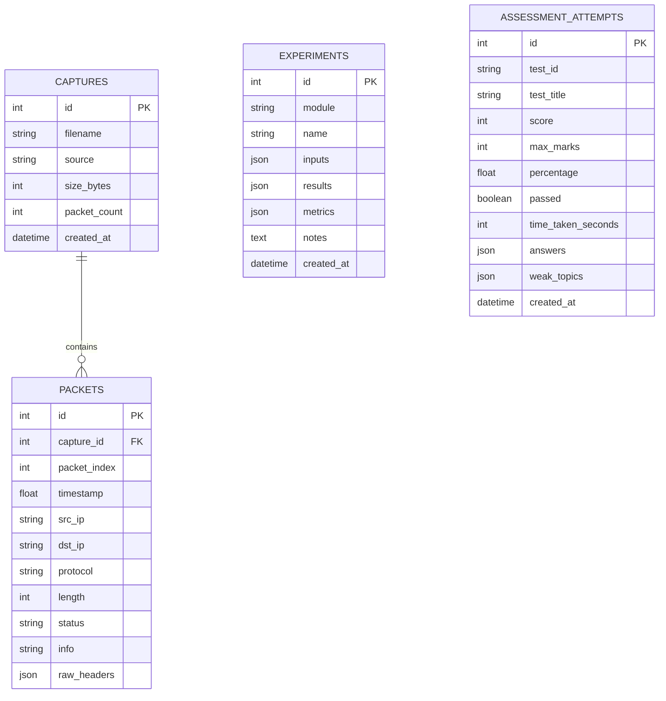

# NetLab System Architecture & Technical Specifications

This document details the architectural design, software components, data flows, and subsystem integrations of **NetLab – Interactive Networking Learning and Analysis Platform**.

---

## 1. High-Level Architecture Overview

NetLab employs a decoupled client-server architecture consisting of a modern single-page application (SPA) frontend and a high-performance Python/FastAPI backend backed by SQLite and Scapy.

```
┌─────────────────────────────────────────────────────────────────────────┐
│                           Client Browser                                │
│   React 18 + TypeScript + Vite + Tailwind CSS + Lucide + Recharts       │
│                                                                         │
│  ┌───────────────┐ ┌───────────────┐ ┌───────────────┐ ┌──────────────┐ │
│  │   Dashboard   │ │ Packet Table  │ │Protocol Ladder│ │Topology Graph│ │
│  └───────────────┘ └───────────────┘ └───────────────┘ └──────────────┘ │
└───────────────────────┬────────────────────────────▲────────────────────┘
                        │ HTTP REST                  │ WebSocket (Live Stream)
                        ▼                            │
┌────────────────────────────────────────────────────┴────────────────────┐
│                    FastAPI Backend (Uvicorn)                            │
│                                                                         │
│  ┌───────────────────────────────────────────────────────────────────┐  │
│  │                     API Routers (/api/v1)                         │  │
│  │  /capture  /packets  /protocols  /topology  /bandwidth            │  │
│  │  /subnetting  /error-detection  /assessments  /experiments        │  │
│  └───────────────────────────────────┬───────────────────────────────┘  │
│                                      │                                  │
│  ┌───────────────────────────────────▼───────────────────────────────┐  │
│  │                    Core Processing Services                       │  │
│  │  • CaptureEngine (Scapy AsyncSniffer + Npcap)                     │  │
│  │  • PacketParser & Dissector (Hex/ASCII + Layer Analysis)          │  │
│  │  • ProtocolSimulator (Canonical Lifelines + Trajectory)           │  │
│  │  • TopologyService (Graph, BFS, Dijkstra Shortest Path)           │  │
│  │  • BandwidthService (Live psutil, Virtual curves, PCAP bins)      │  │
│  │  • SubnettingEngine (IPv4 binary calculations & VLSM)             │  │
│  │  • ErrorDetectionEngine (Parity, Checksum, CRC, Hamming)          │  │
│  │  • AssessmentEngine (Question Bank & Evaluation Sanitizer)        │  │
│  └───────────────────────────────────┬───────────────────────────────┘  │
│                                      │                                  │
│                                      ▼                                  │
│  ┌───────────────────────────────────────────────────────────────────┐  │
│  │              Persistence Layer (SQLAlchemy ORM)                   │  │
│  │           SQLite Database (netlab.db / in-memory tests)           │  │
│  └───────────────────────────────────────────────────────────────────┘  │
└─────────────────────────────────────────────────────────────────────────┘
```

---

## 2. Frontend Architecture

### Core Stack
- **Framework**: React 18 with TypeScript 5.5
- **Build Tool**: Vite 5.4 (ESM modules, Hot Module Replacement)
- **Styling**: Tailwind CSS 3.4 with custom dark-mode slate/navy color scheme
- **Icons**: Lucide React
- **Data Visualization**: Recharts (Pie charts, Bar charts, Area charts)
- **Routing**: React Router DOM v6

### Key Component Design Patterns
- **Canonical Lifelines Pattern (`SequenceDiagram.tsx`)**: Decouples participating entities from step direction. Computes static lifeline coordinates ($X=16\%$ to $84\%$) where Client is anchored on the left and Server on the right. Trajectory direction (`isLeftToRight`) dynamically drives CSS translation animations (`@keyframes packetGlideRight` and `packetGlideLeft`).
- **Interactive SVG Canvas (`TopologyLab.tsx`)**: Renders network topology nodes and links with drag-and-drop coordinates, interactive link state toggling (`UP`/`DOWN`), and packet animation along computed Dijkstra shortest paths.
- **WebSocket Streaming (`PCAPAnalyzer.tsx`)**: Reusable WebSocket hook with reconnect logic, maintaining an in-memory ring buffer of live incoming packets while rendering batched DOM updates.

---

## 3. Backend Architecture

### Core Stack
- **Framework**: FastAPI (Asynchronous Python 3.12+ REST & WebSocket framework)
- **Server**: Uvicorn ASGI
- **Packet Capture & Parsing**: Scapy 2.5 + Npcap (on Windows) / libpcap (on Linux)
- **System Telemetry**: `psutil`
- **ORM & Database**: SQLAlchemy 2.0 with SQLite

### Backend Directory Layout
```
backend/
├── main.py              # Application entry point, CORS, router registrations
├── config.py            # Environment settings and configuration parameters
├── database.py          # SQLAlchemy engine, session maker, get_db dependency
├── errors.py            # Standardized AppError and exception handlers
├── models/              # SQLAlchemy database models
│   ├── capture.py       # Capture metadata and individual packet records
│   ├── experiment.py    # General experiment history records
│   └── assessment.py    # Assessment attempts and evaluation logs
├── schemas/             # Pydantic validation schemas
│   ├── capture.py, packets.py, protocols.py, topology.py
│   ├── bandwidth.py, subnetting.py, error_detection.py, assessments.py
├── services/            # Business logic and computation engines
│   ├── capture_engine.py   # Scapy live capture worker threads & WebSockets
│   ├── packets.py          # PCAP file parsing, layer extraction, hex dumps
│   ├── protocols.py        # Protocol step definitions and state machines
│   ├── topology.py         # Graph representation and pathfinding algorithms
│   ├── bandwidth.py        # Real-time and synthetic throughput engines
│   ├── subnetting.py       # IPv4 address manipulation and bitwise logic
│   ├── error_detection.py  # Checksum, CRC, parity, Hamming code logic
│   └── assessments.py      # Question bank, test generation, scoring
└── tests/               # Pytest automated test suites (77 tests)
```

---

## 4. Database Schema & Data Models

The SQLite relational database maintains all persistent records:



---

## 5. Packet Capture Engine & Real-Time Streaming

### Architecture of `capture_engine.py`
1. **Interface Discovery**: Queries host network interfaces using Scapy's `get_working_ifaces()`, extracting interface names, IPs, MACs, and operational statuses.
2. **Background Sniffing**: Spawns Scapy's `AsyncSniffer` in an isolated daemon thread with specified BPF filters (`filter=bpf_filter`).
3. **Queue & In-Memory Ring Buffer**: Sniffer callbacks push packet summaries to a thread-safe deque (`maxlen=50000`).
4. **WebSocket Fan-Out**: Active WebSocket client connections receive serialized JSON packet metadata immediately upon arrival.
5. **Persistence on Stop**: When capture stops, in-memory packets are written to a temporary PCAP file and flushed into SQLite as an inspectable capture session.

---

## 6. Educational Simulation Engines

### Protocol State Machine (`protocols.py`)
- Provides deterministic 7-protocol step sequences (TCP, UDP, DNS, DHCP, ARP, HTTP, ICMP).
- Each step defines: `from`, `to`, `via`, `title`, `protocol`, `summary`, `explanation`, and full simulated protocol header fields (`packet.fields`).

### Network Graph & Path Calculation (`topology.py`)
- Represents network topologies as adjacency matrices.
- Computes connected components using Breadth-First Search (BFS).
- Computes optimal delivery paths using Dijkstra's shortest-path algorithm weighted by link latency.
- Calculates end-to-end packet delivery probability:
  $$P(\text{delivery}) = \prod_{i=1}^{\text{hops}} \left(1 - \frac{\text{loss\_pct}_i}{100}\right)$$

### Error Detection Algorithms (`error_detection.py`)
- **Parity**: Computes parity bit satisfying even or odd bit parity.
- **Internet Checksum**: Computes 16-bit one's complement sum of 16-bit blocks (RFC 1071).
- **CRC**: Performs modulo-2 polynomial division using XOR operations; outputs step-by-step bit alignments.
- **Hamming (7,4)**: Generates 3 parity bits ($p_1, p_2, p_4$); detects single-bit errors via syndrome calculation and corrects the erroneous bit.

---

## 7. Operational Data Flow & Source Classification

NetLab strictly maintains and displays data provenance across three categories:

| Provenance Label | Data Origin | Guarantee & Purpose | Modules |
| :--- | :--- | :--- | :--- |
| **LIVE** | Host network adapter | Genuine physical frames captured via Npcap/Scapy or actual host telemetry via `psutil`. | Packet Analyzer (Live Capture tab), Bandwidth Monitor (Live Interface) |
| **IMPORTED** | Uploaded file | Static packet captures extracted from uploaded `.pcap`, `.pcapng`, or `.cap` files. | PCAP Analyzer (PCAP tab), Bandwidth Monitor (PCAP analysis) |
| **VIRTUAL** | Mathematical simulation | Deterministic algorithmic models for teaching and experimentation. Never misrepresented as real network traffic. | Protocol Lab, Topology Simulator, Bandwidth (Virtual curves), Error Detection |
